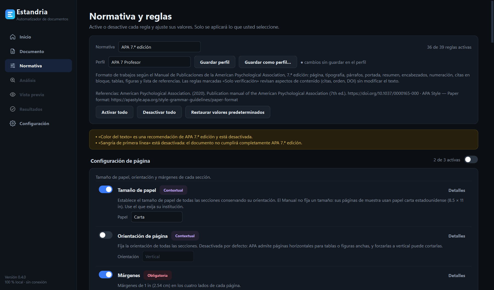
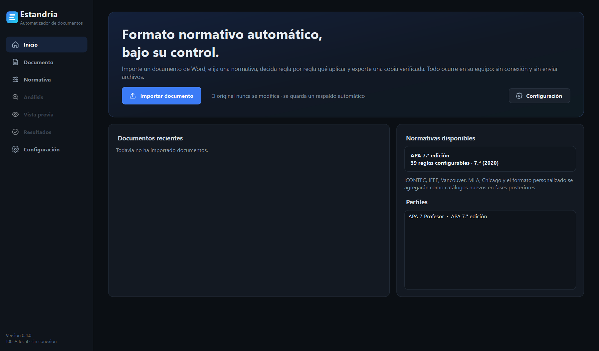
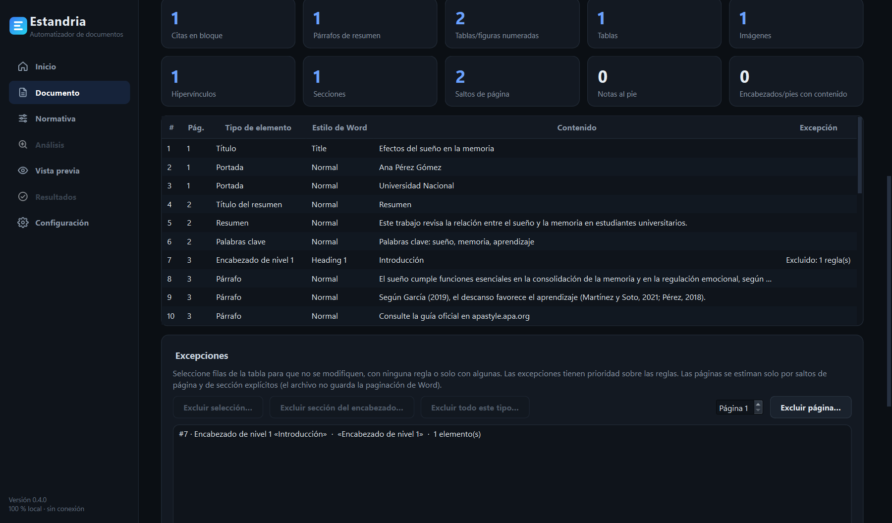
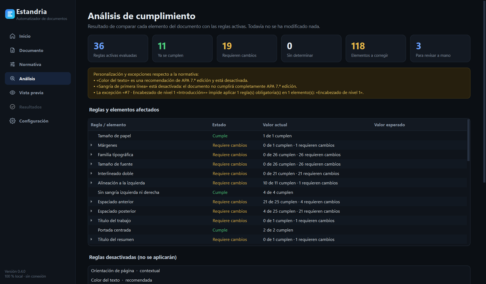
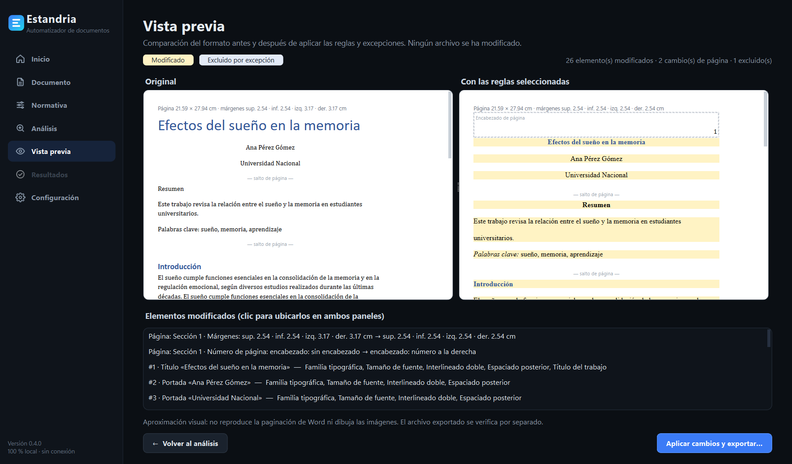
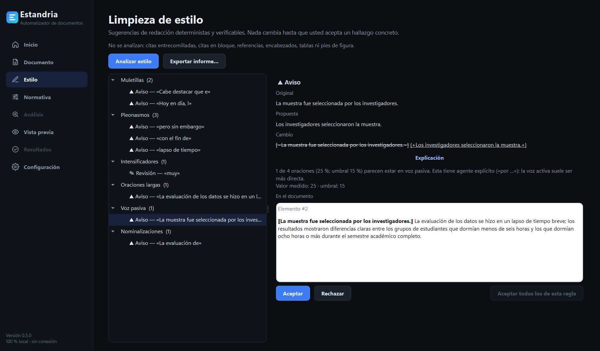

<div align="center">


# Estandria

**Formato normativo automático para documentos de Word, bajo tu control.**

Importa un `.docx`, elige una normativa como APA 7, decide regla por regla qué aplicar y exporta una
copia verificada. Sin conexión, sin enviar tus documentos a ningún servidor y sin tocar el original.




</div>

---

## ¿Por qué Estandria?

Dar formato APA a mano es lento y fácil de hacer mal. Las herramientas que lo «arreglan todo» de una
vez no dejan elegir, y a veces rompen tablas, imágenes o encabezados.

Estandria funciona al revés: **primero analiza** el documento, **te muestra** qué cumple y qué no, **te
deja decidir** cada regla y cada excepción, y **solo entonces** crea un archivo nuevo, que comprueba
antes de entregártelo.

> ¿Tu profesor no exige la sangría de primera línea? Desactívala y aplica el resto de APA 7. Estandria
> te avisará de que el documento ya no cumple la norma completa y respetará tu decisión.

## Características

| | |
|---|---|
| 🎛️ **Control regla por regla** | 39 reglas de APA 7.ª edición, cada una con su interruptor, sus valores editables y la sección del Manual de la que sale. |
| 🔍 **Análisis antes de tocar nada** | Reconoce portada, título, resumen, encabezados de 5 niveles, párrafos, listas, citas, tablas, figuras, notas y referencias. |
| 👁️ **Vista previa antes/después** | El original y el resultado lado a lado, con los cambios resaltados, generada en memoria. |
| 🛡️ **Excepciones** | «No toques esta tabla», «conserva el formato de este título», «excluye esta sección»: tus excepciones mandan. |
| 📚 **Citas y referencias** | Señala citas sin referencia, referencias que no se citan, orden alfabético, DOI mal escritos y años ausentes, sin reescribir tu texto. |
| ✍️ **Limpieza de estilo** | Señala muletillas, pleonasmos, repeticiones, oraciones largas, pasivas y nominalizaciones, con una reescritura propuesta que aceptas o rechazas una por una. Sin puntuaciones ni porcentajes: cada hallazgo muestra su valor medido y su umbral. |
| 💾 **Perfiles** | Guarda configuraciones como «APA 7 Profesor» o «APA 7 Universidad» y cárgalas en un clic. |
| ✅ **Exportación verificada** | Cada archivo exportado se vuelve a abrir y se comprueba: el texto debe ser idéntico (huella SHA-256) y no puede faltar ninguna tabla, imagen ni enlace. |
| 🔒 **Privado por diseño** | Todo ocurre en tu equipo. Sin cuentas, sin nube, sin telemetría. |

## Capturas

<table>
  <tr>
    <td></td>
    <td></td>
  </tr>
  <tr>
    <td align="center"><b>Inicio</b>: documentos recientes, normativas y perfiles</td>
    <td align="center"><b>Documento</b>: estructura detectada y excepciones</td>
  </tr>
  <tr>
    <td></td>
    <td></td>
  </tr>
  <tr>
    <td align="center"><b>Análisis</b>: qué cumple, qué cambiará y qué revisar</td>
    <td align="center"><b>Vista previa</b>: original frente a resultado</td>
  </tr>
  <tr>
    <td colspan="2"></td>
  </tr>
  <tr>
    <td colspan="2" align="center"><b>Limpieza de estilo</b>: cada sugerencia con su explicación, su umbral y el cambio propuesto</td>
  </tr>
</table>

## Limpieza de estilo

Una revisión de redacción **determinista y verificable**, separada del formato:

| Regla | Qué señala | Umbral |
|---|---|---|
| Muletillas | «cabe destacar que», «hoy en día»… | 1 aparición |
| Pleonasmos | «pero sin embargo» → «pero», «con el fin de» → «para»… | 1 aparición |
| Adjetivos valorativos | «fundamental», «crucial», «innovador»… | 3 por cada 1000 palabras |
| Intensificadores | «muy», «realmente», «sumamente»… | 2 por cada 1000 palabras |
| Repetición léxica | la misma raíz en un párrafo de 40 palabras o más | 3 veces |
| Oraciones largas | con punto de corte propuesto cuando hay uno claro | más de 38 palabras |
| Ritmo uniforme | oraciones de longitud muy pareja | desviación menor que 4 |
| Voz pasiva | propone la activa solo si hay agente («por …») | 15 % de las oraciones |
| Nominalizaciones | «la realización de» → «realizar» | 1 aparición |

- **No modifica nada hasta que aceptas un hallazgo concreto.** Cada aceptación crea una nueva copia de
  trabajo y el original nunca cambia.
- **Sin puntuaciones:** no hay nota, porcentaje ni índice global. Toda cifra se puede recalcular a mano
  desde el fragmento señalado.
- **No detecta ni juzga autoría.** Es una ayuda de redacción para el autor, no un clasificador.
- **Exclusiones:** no toca citas entre comillas, citas en bloque, referencias, encabezados, tablas ni pies
  de figura, porque alterar una cita es alterar una fuente.
- **Ampliable sin programar:** los léxicos y umbrales están en
  [`app/style/lexicon_es.json`](app/style/lexicon_es.json).
- **Idiomas:** la interfaz del módulo está en español latinoamericano, español de España e inglés. Los
  léxicos son del español, así que con documentos en inglés el módulo se desactiva y lo avisa.

## Descarga y uso

1. Entra en **[Releases](../../releases)** y descarga una de las dos versiones:
   - **`Estandria-<versión>-windows-x64.exe`**: un solo archivo, listo para abrir. Tarda unos segundos
     más en arrancar porque se descomprime cada vez.
   - **`Estandria-<versión>-windows-x64.zip`** (recomendado): descomprímelo y abre `Estandria\Estandria.exe`.
     Arranca más rápido.
2. No necesitas instalar Python ni ninguna otra cosa.
3. **Importa** tu documento (botón o arrastrar y soltar), elige la **normativa**, ajusta las reglas,
   revisa el **análisis** y la **vista previa**, y pulsa **Aplicar cambios y exportar**.

> [!NOTE]
> El ejecutable no está firmado digitalmente, así que Windows SmartScreen puede mostrar «Windows protegió
> su PC» la primera vez. Pulsa **Más información → Ejecutar de todas formas**. Si prefieres no hacerlo,
> puedes [ejecutarlo desde el código](docs/DESARROLLO.md#ejecutar-desde-el-código).

## Reglas de APA 7 incluidas

| Categoría | Qué hace |
|---|---|
| Página | Tamaño de papel (conservando la orientación de cada sección), márgenes de 2.54 cm, orientación opcional |
| Tipografía | Fuente y tamaño vinculados (Times New Roman 12, Calibri 11…), texto negro, también dentro de las tablas |
| Párrafos | Doble espacio, alineación a la izquierda, sangría de 1.27 cm, sin espacio extra entre párrafos |
| Estructura | Portada centrada, título en negrita, resumen en página nueva, «Palabras clave:» en cursiva, 5 niveles de encabezado |
| Numeración | Número de página arriba a la derecha desde la portada, sin reinicios |
| Citas | Citas en bloque con sangría de 1.27 cm · *revisión:* cada cita tiene su referencia |
| Referencias | Título centrado, página nueva, sangría francesa, doble espacio · *revisión:* citadas, orden alfabético, DOI, año |
| Tablas y figuras | Número en negrita, título en cursiva, nota con «Nota.» en cursiva |

Cada regla indica si es **obligatoria**, **recomendada** o **contextual**, y cita el *Publication Manual
of the American Psychological Association* (7.ª ed., 2020). Cuando el Manual no exige algo de forma
explícita, como el color del texto o el tamaño de papel, el programa lo dice.

Lo que exigiría reescribir tu texto (completar una referencia, reordenar la lista, cambiar mayúsculas)
**nunca se hace de forma automática**: se señala como «Para revisar».

## Tu documento está a salvo

- **El original nunca se modifica.** Se trabaja sobre una copia, y otra queda como copia de seguridad.
- **Solo cambia el formato.** El texto no se toca. Tablas, imágenes, ecuaciones, cuadros de texto,
  hipervínculos y notas al pie se conservan.
- **Lo que no se entiende, no se toca**, y el programa lo dice.
- **Cada exportación se verifica.** Si el archivo generado no coincide en contenido con el original,
  no se guarda.
- Tus perfiles y preferencias se guardan en una base de datos local en `%LOCALAPPDATA%\Estandria`.

## Limitaciones conocidas

- **Formatos:** por ahora solo se procesan `.docx`. Los archivos `.doc`, `.odt` y `.rtf` se reconocen y el
  programa explica cómo convertirlos.
- **Detección aproximada:** la portada, el resumen, las referencias, las citas en bloque y los rótulos de
  tablas se reconocen por patrones habituales. La página *Documento* muestra cómo se clasificó cada párrafo,
  y las excepciones permiten corregirlo.
- **Vista previa:** muestra el formato, pero no la paginación exacta de Word ni las imágenes.
- **Páginas estimadas:** un `.docx` no guarda páginas. Las excepciones por página usan la última paginación
  guardada por Word o, si no existe, solo los saltos de página explícitos.
- **Normativas:** por ahora solo APA 7. ICONTEC, IEEE, Vancouver, MLA, Chicago y un formato personalizado están previstos.

## Hoja de ruta

- [x] Importación, análisis y exportación verificada de DOCX
- [x] Motor de reglas JSON con dependencias, conflictos y vínculos
- [x] APA 7.ª edición (39 reglas)
- [x] Excepciones y vista previa antes/después
- [x] Perfiles y configuración (SQLite)
- [x] Limpieza de estilo determinista
- [ ] DOC, ODT y RTF mediante conversión
- [ ] Nuevas normativas: ICONTEC, IEEE, Vancouver, MLA, Chicago, formato personalizado
- [ ] Instalador

## Para desarrolladores

¿Quieres ejecutarlo desde el código, compilarlo o crear tu propia normativa? Las normativas son archivos
JSON y no requieren programar. Consulta la **[guía técnica](docs/DESARROLLO.md)**.

```powershell
py -3 -m venv .venv
.\.venv\Scripts\python.exe -m pip install -r requirements.txt -r requirements-dev.txt
.\.venv\Scripts\python.exe main.py
```

## Licencia

Estandria es software de **código disponible** bajo la licencia
**[PolyForm Noncommercial 1.0.0](LICENSE.md)**.
**© 2026 Miguel Angel Martinez Utria.** Ver [`NOTICE.md`](NOTICE.md).

- ✅ **Puedes** usarlo, estudiarlo, modificarlo y compartirlo con fines **no comerciales**: uso personal,
  estudiantes, docentes, investigación, instituciones educativas y organizaciones sin ánimo de lucro.
- ❌ **No puedes** venderlo, integrarlo en un producto o servicio de pago, ni usarlo con fines comerciales
  sin una licencia aparte del autor.
- Al compartirlo debes incluir la licencia y el aviso de copyright.

Para un uso comercial, contacta al autor a través de su perfil de GitHub.

Este resumen no sustituye al texto de la licencia. Los componentes de terceros (Qt/PySide6, python-docx,
lxml y Python) conservan sus propias licencias: ver [`THIRD_PARTY_NOTICES.md`](THIRD_PARTY_NOTICES.md).

---

<div align="center">
<sub>Creado por Miguel Angel Martinez Utria · Hecho con cuidado para quienes escriben trabajos académicos. APA es una marca de la American
Psychological Association; Estandria es un proyecto independiente, sin relación con ella.</sub>
</div>
