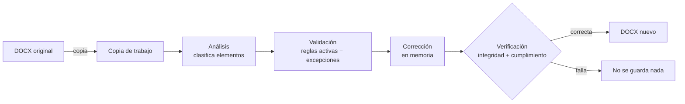

# Guía técnica de Estandria

Documentación para ejecutar el proyecto desde el código, compilarlo, entender su arquitectura y crear o
modificar catálogos de normativas.

## Ejecutar desde el código

Requiere Windows 10/11 de 64 bits y Python 3.11 o superior (probado con 3.13).

```powershell
py -3 -m venv .venv
.\.venv\Scripts\python.exe -m pip install -r requirements.txt -r requirements-dev.txt
.\.venv\Scripts\python.exe main.py
```

Pruebas (122, sobre documentos `.docx` reales generados por `tests/samples.py`):

```powershell
.\.venv\Scripts\python.exe -m pytest -q
```

Regenerar los documentos de ejemplo de `tests/documentos/`:

```powershell
.\.venv\Scripts\python.exe -m tests.samples
```

## Compilar el ejecutable

```powershell
.\build.bat
```

`build.bat` crea el entorno si no existe, instala las dependencias, ejecuta las pruebas y compila con
PyInstaller (configuración en `estandria.spec`).

| Modo | Comando | Resultado | Tamaño aprox. |
|---|---|---|---|
| `onedir` (recomendado) | `build.bat` | `dist\Estandria\Estandria.exe` y su carpeta `_internal` | 102 MB |
| `onefile` | `build.bat onefile` | `dist\Estandria.exe` | 41 MB |

`onedir` arranca más rápido y mantiene las bibliotecas de Qt como archivos reemplazables, como pide la LGPL.
Es el formato recomendado para publicar.

### Comprobar un ejecutable compilado

```powershell
.\dist\Estandria\Estandria.exe --autoprueba ruta\documento.docx ruta\carpeta_salida
```

La autoprueba abre la ventana real y comprueba de punta a punta:
- los perfiles en SQLite;
- la vista previa;
- el procesamiento del documento con APA 7 y una excepción.

Escribe `autoprueba.json` en la carpeta de salida y devuelve el código 0 si todo es correcto.

## Arquitectura

```
main.py                         arranque, registro de errores, --autoprueba
app/
  paths.py                      rutas de recursos (código o PyInstaller) y datos del usuario
  formats/
    __init__.py                 registro de formatos y detección por firma binaria
    docx_handler.py             apertura validada, recorrido, formato efectivo, huella de integridad
    docx_operations.py          operaciones de formato: cada una sabe comprobar y aplicar
    docx_preview.py             HTML del formato efectivo para la vista previa
  core/
    document_loader.py          inspección del archivo, copia de trabajo y copias de seguridad
    document_analyzer.py        etapa 1: clasifica cada elemento y estima su página
    citations.py                detección de citas autor-fecha y cruce con referencias
    rule_engine.py              catálogos JSON, selección, dependencias, conflictos, vínculos, avisos
    exceptions.py               excepciones del usuario (elemento, tipo, sección, página)
    document_validator.py       etapa 2: compara elementos con reglas (no modifica)
    document_processor.py       etapa 3: aplica (en memoria o con exportación verificada)
    document_exporter.py        guardado seguro (temporal → verificación → destino)
  database/
    database.py                 SQLite con migraciones y recuperación de archivos dañados
    profile_repository.py       perfiles
    settings_repository.py      preferencias
  standards/apa7/rules.json     catálogo APA 7
  style/                        limpieza de estilo: texto con posiciones, reglas y léxico
  i18n/                         catálogos de textos (es-419, es-ES, en)
  ui/                           PySide6: ventana, páginas, diálogos, tema, tareas en segundo plano
assets/                         hoja de estilos Dark Tech e iconos SVG
tests/                          pruebas y generador de documentos de prueba
tools/make_icon.py              genera assets/icons/app.ico a partir de logo.svg
```



**Decisión de diseño:** las reglas no se programan por normativa. Cada regla del JSON referencia una
*operación* genérica (`"tipo": "interlineado"`, `"sangria_francesa"`…) y un *alcance* (tipos de
elemento). Una normativa nueva que use operaciones existentes se agrega solo con un archivo
`app/standards/<id>/rules.json`, sin escribir código.

## Crear o modificar una normativa

### Formato de una regla

```json
{
  "id": "par_interlineado",
  "nombre": "Interlineado doble",
  "descripcion": "…",
  "categoria": "parrafos",
  "tipo": "interlineado",
  "alcance": ["parrafo", "lista"],
  "parametros": {
    "multiplo": {"etiqueta": "Interlineado", "tipo": "numero", "valor": 2.0, "minimo": 1, "maximo": 3,
                 "paso": 0.05, "unidad": "líneas", "conformes": [2.0]}
  },
  "activa_por_defecto": true,
  "dependencias": [],
  "conflictos": [],
  "clasificacion": "obligatoria",
  "edicion": "7.ª (2020)",
  "fuente": "Manual APA 7.ª ed., §2.21"
}
```

- **Tipos de parámetro:** `numero`, `opcion` (con `opciones`; `editable` admite texto libre) y `booleano`.
- **`conformes`:** valores que cumplen la normativa. Si se omite, solo cumple el predeterminado. Elegir otro genera un aviso.
- **Clasificación:** `obligatoria`, `recomendada` o `contextual`.
- **Operaciones de formato:**
  - tipografía: `familia_fuente`, `tamano_fuente`, `color_fuente` (también admiten el alcance `tabla`: todo el texto de sus celdas);
  - párrafo: `interlineado`, `alineacion`, `sangria_primera_linea`, `sangrias_laterales`, `espaciado_anterior`, `espaciado_posterior`, `sangria_francesa`;
  - bloques y títulos: `formato_titulo`, `bloque` (alineación + sangrías), `etiqueta_inicial` (cursiva de «Palabras clave:», «Nota.»), `salto_pagina_antes`;
  - página (alcance `secciones`): `margenes`, `tamano_papel`, `orientacion`, `numero_pagina`, `numeracion_inicio`.
- **Operaciones de solo verificación:** `citas_con_referencia`, `referencia_citada`, `orden_alfabetico`, `formato_doi`, `anio_referencia`.
- **Alcances:**
  - documento: `portada`, `titulo`, `subtitulo`, `encabezado_1`…`encabezado_9`, `titulo_resumen`, `resumen`, `palabras_clave`;
  - texto: `parrafo`, `lista`, `cita_bloque`;
  - tablas y figuras: `leyenda` (número), `titulo_leyenda`, `nota_tabla`, `leyenda_combinada`, `tabla`;
  - referencias: `titulo_referencias`, `referencia`;
  - página: `secciones`.
- **`dependencias`:** activar la regla activa también estas; desactivar una dependencia desactiva lo que depende de ella.
- **`conflictos`:** reglas que no pueden estar activas a la vez; activar una desactiva la otra y se explica por qué.

### Vínculos entre valores

Cuando el valor de un parámetro determina el de otro, el catálogo lo declara en `vinculos`:

```json
"vinculos": [{
  "id": "fuente_tamano",
  "descripcion": "El Manual asocia cada fuente con un tamaño.",
  "origen":  {"regla": "tip_familia", "parametro": "familia"},
  "destino": {"regla": "tip_tamano",  "parametro": "tamano"},
  "valores": {"Times New Roman": 12, "Calibri": 11, "Arial": 11},
  "fuente": "Manual APA 7.ª ed., §2.19"
}]
```

Al cambiar el origen, el destino se ajusta y se explica. Si el usuario cambia después el destino, la
combinación se informa como aviso.

### Validación de catálogos

Un catálogo con errores no se carga, y el mensaje indica la regla y el problema. Se comprueba:

- identificadores únicos, categorías, clasificaciones y alcances conocidos;
- que cada regla use su operación como esta espera: nivel, parámetros exactos, tipos y valores admitidos;
- que las dependencias y los conflictos existan, y que no haya reglas incompatibles activas por defecto;
- **configuraciones contradictorias:** dos reglas que escriben la misma propiedad sobre el mismo tipo de
  elemento deben declararse en `conflictos`, de modo que nunca puedan estar activas a la vez;
- vínculos que apunten a reglas y parámetros existentes, con valores válidos y coherentes con los predeterminados.

## Limpieza de estilo (`app/style/`)

| Archivo | Responsabilidad |
|---|---|
| `text_model.py` | Texto de revisión con posiciones fieles al documento y aplicación de cambios aceptados |
| `rules.py` | Las nueve reglas, el plegado de tildes, la raíz aproximada y la detección de idioma |
| `lexicon_es.json` | Léxicos y umbrales (se amplían sin tocar código) |
| `app/i18n/*.json` | Explicaciones y etiquetas: `es-419`, `es-ES` y `en` |

**Texto de revisión.** Es la unión de los bloques del cuerpo en orden, separados por `\n`. Cada párrafo
aporta la concatenación de sus nodos `<w:t>`; tablas y otros bloques aportan una cadena vacía. Por eso
cada posición corresponde a un carácter concreto del DOCX, y `texto[ini:fin] == excerpt` siempre.

**Plegado de tildes.** Reemplaza cada carácter por exactamente uno (`á→a`, `ñ→n`…, en minúscula). No se
usa `normalize('NFD')`, porque cambia la longitud y rompería las posiciones.

**Raíz aproximada.** Quita `-es`/`-s` y trunca a 7 caracteres. Puede agrupar palabras distintas; por eso
el umbral es 3 y el hallazgo es revisable.

**Contrato del hallazgo.** `ruleId, severity, ini, fin, excerpt, medido, umbral, explicacion,
propuesta, aceptable`, más dos campos:
- `elemento`: bloque del documento, para navegar hasta el hallazgo;
- `contexto`: valores que completan la explicación, por ejemplo cuántas palabras se analizaron.

No existe ningún campo de puntuación ni de agregado, y una prueba lo verifica.

**Al aceptar.** Se copia la copia de trabajo actual, se aplican los cambios de atrás hacia adelante
(omitiendo los solapados) y se verifica que cada párrafo quede exactamente como se esperaba. El
documento original nunca se modifica.

## Datos locales

| Qué | Dónde |
|---|---|
| Perfiles y preferencias (SQLite) | `%LOCALAPPDATA%\Estandria\estandria.db` |
| Copias de seguridad de los documentos importados | `%LOCALAPPDATA%\Estandria\respaldos\` (configurable) |
| Registro de errores | `%LOCALAPPDATA%\Estandria\registro.log` |

- **Esquema de la base:** se actualiza con migraciones numeradas (`PRAGMA user_version`).
- **Base dañada:** si el archivo no es una base SQLite válida, se aparta con el sufijo `.danada-<fecha>` y se crea una nueva.
- **Base inaccesible:** si no puede abrirse, la aplicación funciona en memoria y avisa de que no se guardará nada.
